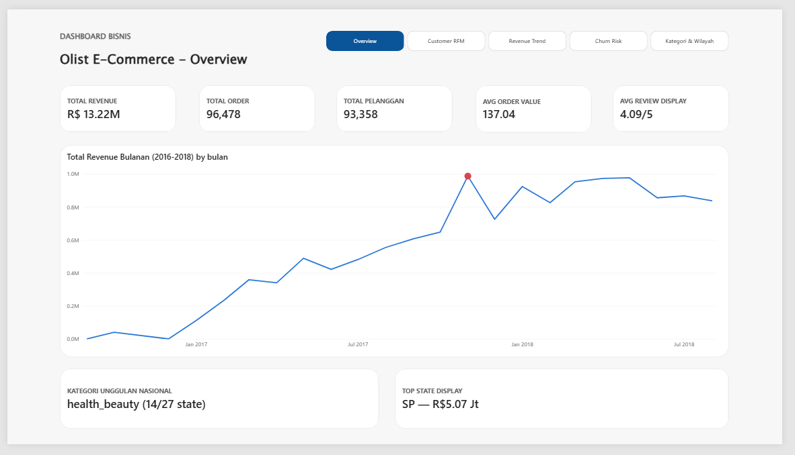
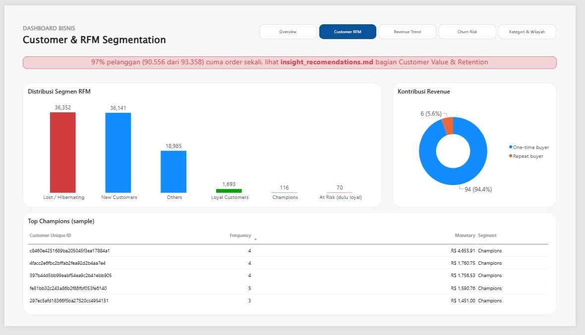
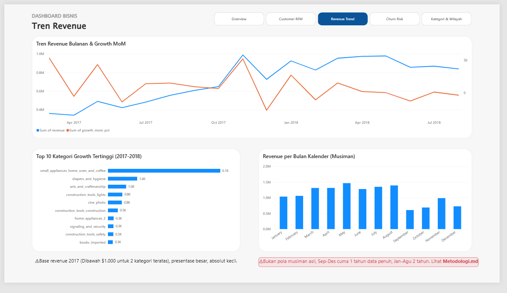
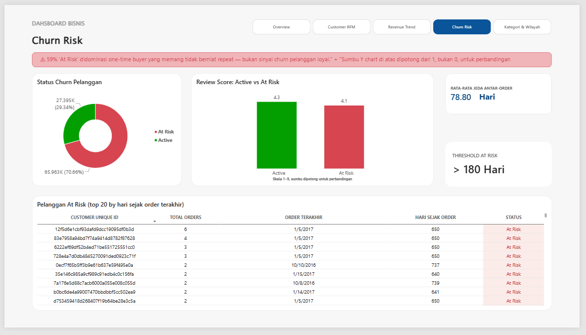
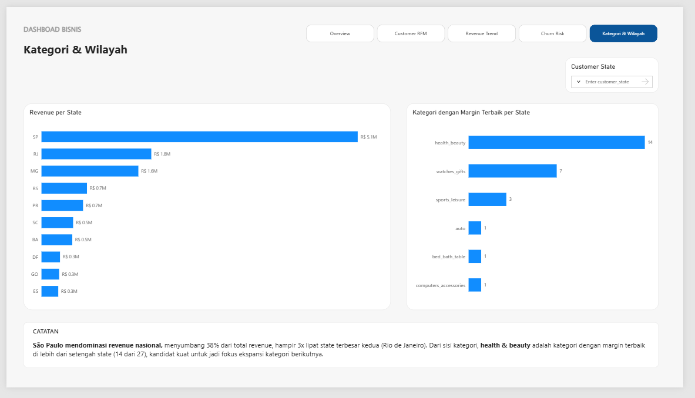

# SQL Business Dashboard - Olist Brazilian E-Commerce

Data Analyst portfolio project: a business dashboard built on **advanced SQL (CTEs, window functions,
multi-table joins)** over an e-commerce dataset, designed to answer concrete business questions rather
than to collect charts.

  

*Bahasa Indonesia: [README.id.md](README.id.md)*

> **Data Engineer version:** the analysis in this repo was extended into an automated data pipeline in
> [olist-data-pipeline](https://github.com/rohid001/olist-data-pipeline): idempotent monthly ingestion,
> dbt with 71 tests, Airflow orchestration, GitHub Actions CI, and the same dashboard now reading the
> `marts` schema. Its numbers match the query results in this repo (checked automatically).

---

## Contents

- [Background](#background)
- [Dataset](#dataset)
- [Business Questions](#business-questions)
- [Tech Stack](#tech-stack)
- [Repository Structure](#repository-structure)
- [Methodology](#methodology)
- [Dashboard](#dashboard)
- [Key Insights & Business Recommendations](#key-insights--business-recommendations)
- [How to Reproduce](#how-to-reproduce)
- [Technical Findings Worth Highlighting](#technical-findings-worth-highlighting)

---

## Background

This project simulates the end-to-end work of a Data Analyst: framing business questions, auditing the
quality of raw data, writing analytical SQL, and presenting the results in an interactive dashboard that
decision makers can use.

The main focus is **SQL depth**: RFM segmentation, window functions for growth rates, and churn
analysis, with Power BI as the presentation layer.

## Dataset

**[Olist Brazilian E-Commerce Public Dataset](https://www.kaggle.com/datasets/olistbr/brazilian-ecommerce)**
from Kaggle: real (anonymised) transactions from the largest marketplace in Brazil, 2016–2018.

| Item | Detail |
|---|---|
| Orders | ~99,441 |
| Unique customers | 96,096 (`customer_unique_id`) |
| Period | September 2016 – August 2018 (analysed *delivered* orders; raw data runs to October 2018) |
| Raw files | 9 CSV files (customers, orders, order_items, order_payments, order_reviews, products, sellers, geolocation, category translation) |
| Original language | Portuguese (product category names) |

## Business Questions

The dashboard answers the following business questions (the full list of 12 questions is in
`docs/business_questions.md`, in Indonesian):

1. **Customer Value** - Who are the most valuable customers, and how are they segmented (RFM)?
2. **Revenue Trend** - What is the monthly revenue trend, and which categories grew or declined from 2017 to 2018?
3. **Seasonality** - Is there a seasonal pattern in revenue across the calendar year?
4. **Churn Signal** - Which signals indicate customers at risk of churning, and do they correlate with review scores?
5. **Category & Region** - Which product categories are the most profitable in each region, and which regions are the most valuable by revenue?

## Tech Stack

| Category | Tool |
|---|---|
| Database | PostgreSQL |
| DB client | DBeaver |
| Data loading & validation | Python (pandas, SQLAlchemy, psycopg2) in Jupyter Notebook |
| Dashboard | Power BI Desktop |
| Dataset source | Kaggle (`kagglehub`) |
| Version control | Git + GitHub |

## Repository Structure

```
olist-sql-dashboard/
├── data/
│   ├── raw/                          # 9 original CSV files from Kaggle (not committed, see .gitignore)
│   └── processed/                    # query results exported for validation (not committed)
├── sql/
│   ├── 01_schema.sql                 # DDL for 9 raw tables (no constraints)
│   ├── 02_finalize_schema.sql        # PRIMARY KEY, FOREIGN KEY, INDEX, dedup view
│   ├── 03_rfm_analysis.sql           # Q1 RFM segmentation, Q2 buyer type
│   ├── 04_revenue_trend.sql          # Q3 revenue trend, Q4 category growth, Q5 seasonality
│   ├── 05_churn_indicator.sql        # Q6 churn gap & status, Q7 review score vs churn
│   ├── 06_category_region_analysis.sql # Q8 top category per state, Q9 revenue per state
│   └── 07_overview_kpi.sql           # KPI aggregates for dashboard page 1
├── scripts/
│   └── download-dataset.ipynb        # download the dataset with kagglehub
├── notebooks/
│   ├── 01_load_to_postgres.ipynb     # load the 9 CSV files into Postgres
│   ├── 02_data_audit.ipynb           # data quality audit
│   └── 03_query_validation_viz.ipynb # visual validation of every query result
├── dashboard/
│   ├── olist_dashboard.pbix
│   └── screenshots/                  # one screenshot per dashboard page
├── docs/
│   ├── business_questions.md         # 12 business questions (in Indonesian)
│   ├── methodology.md                # design decisions (in Indonesian)
│   └── insights_recommendations.md   # insights and recommendations (in Indonesian)
├── README.md
├── README.id.md
├── requirements.txt
└── .gitignore
```

## Methodology

The approach is **audit first, constrain later**, instead of assuming the data is clean from the start.

1. **Raw layer without constraints.** The 9 tables are created without `PRIMARY KEY`/`FOREIGN KEY` so
   the load does not fail on data problems. Those problems are exactly what the audit should find, not
   hide behind constraints that reject problematic rows up front.
2. **Audit before writing analytical queries.** Findings: 814 duplicated `review_id` values, 2 product
   categories without an official translation, and 775 orders without `order_items` (valid, not a bug).
3. **Constraints added once the problems are known.** Final `PRIMARY KEY`/`FOREIGN KEY`/`INDEX`, plus
   `VIEW order_reviews_dedup` to handle duplicates without changing the original data.
4. **`customer_unique_id`, not `customer_id`, identifies a customer.** In this dataset `customer_id` is
   unique per *order*, not per customer; using it would break every RFM and retention analysis.

Full details and every design decision are in [`docs/methodology.md`](docs/methodology.md) (in Indonesian).

## Dashboard

A 5-page dashboard built by importing **SQL query results directly** into Power BI (Native SQL
statements) instead of raw tables recalculated with DAX. This keeps the business logic (RFM scoring,
growth rates, churn threshold) in a single source of truth in SQL, with Power BI as a pure
visualisation layer.

| Page | Contents |
|---|---|
| **1. Overview** | Main KPIs (revenue, orders, customers, AOV, review score), monthly revenue trend, top category and state |
| **2. Customer & RFM** | RFM segment distribution, revenue share of one-time vs repeat buyers, Top Champions table |
| **3. Revenue Trend** | Revenue trend and MoM growth, top 10 fastest-growing categories, monthly seasonality |
| **4. Churn Risk** | Customer churn status, review score of Active vs At Risk customers, at-risk customer table |
| **5. Category & Region** | Revenue per state, top 10 states, best-margin category per state |

**Screenshots:**

| Overview | Customer & RFM |
|---|---|
|  |  |

| Revenue Trend | Churn Risk |
|---|---|
|  |  |

| Category & Region |
|---|
|  |

## Key Insights & Business Recommendations

Summary; full details for each point (including supporting numbers) are in
[`docs/insights_recommendations.md`](docs/insights_recommendations.md) (in Indonesian).

- **97% of customers ordered only once.** The repeat-customer base is very thin, so retention and
  loyalty programmes offer a bigger opportunity than continuing to acquire new customers.
- **Revenue is highly concentrated geographically.** São Paulo contributes 38.3% of national revenue,
  about 2.9 times the second-largest state (Rio de Janeiro).
- **`health_beauty` is the most consistently leading category**: the best-margin category in 14 of 27
  states, far ahead of any other category.
- **"At Risk" churn (more than 180 days without an order) covers 70.66% of customers, but most of them
  are one-time buyers who never intended to come back**, not loyal customers who were lost.
  Recommendation: focus retention on customers who **did** repeat and then stopped, not on the whole
  At Risk population.
- **The monthly seasonal pattern (Sep–Dec vs Jan–Aug) is not yet representative.** Sep–Dec has only one
  full year of data (2016 is partial and 2018 ends early), while Jan–Aug has two. The visible difference
  most likely comes from the unequal number of years, not a real seasonal pattern; this caveat matters to
  avoid wrong decisions.

## How to Reproduce

Requirements: PostgreSQL, DBeaver (or another SQL client), Python 3.9+, Power BI Desktop (Windows).

1. **Clone the repo and install the Python dependencies**
   ```bash
   git clone https://github.com/rohid001/olist-sql-dashboard.git
   cd olist-sql-dashboard
   pip install -r requirements.txt
   ```
2. **Set up the database connection**: create a `.env` file in the root with `DB_HOST`, `DB_PORT`,
   `DB_NAME`, `DB_USER`, and `DB_PASSWORD` (used by `notebooks/01_load_to_postgres.ipynb`).
3. **Download the dataset**: run `scripts/download-dataset.ipynb` (automatic via `kagglehub`; the
   files go to `data/raw/`).
4. **Create the schema and load the data**
   - Run `sql/01_schema.sql` in DBeaver (creates the 9 raw tables)
   - Run `notebooks/01_load_to_postgres.ipynb` (loads the CSV files into Postgres)
5. **Finalise the schema**: run `sql/02_finalize_schema.sql` step by step (STEP 1 to STEP 4 are marked
   in the file).
6. **Run the analytical queries**: `sql/03` to `sql/07`, in any order (they do not depend on each other).
7. **Open the dashboard**: open `dashboard/olist_dashboard.pbix` in Power BI Desktop and point the
   Postgres connection to your local instance (Power BI asks for credentials the first time a query
   runs).

## Technical Findings Worth Highlighting

A few points recorded on purpose as material for technical discussions (for example, in interviews):

- **A non-deterministic `NTILE()` bug found by cross-validating SQL against Python.** The RFM frequency
  score first used `NTILE(5)`, but 97% of customers have frequency = 1. On such a skewed column `NTILE`
  splits identical values randomly into 5 different quintiles (only a 22.6% match rate when re-validated).
  Fix: a business-rule `CASE` statement for the F score, and deterministic tie-breakers for the R and M
  scores. Details in `docs/methodology.md`, point 6.
- **The churn reference date must be computed from ALL orders, not only `delivered` ones.** This mistake
  appeared in the Python validation script (not in the project SQL) and was confirmed by a manual
  cross-check.
- **Power BI's Top N filter is unreliable when combined with other filters on the same visual.** Solved
  by replacing it with a rank column computed with `RANKX()` in DAX and filtered manually, instead of the
  built-in Top N feature.

---

*Built as part of a Data Analyst portfolio. The dataset belongs to Olist and is redistributed by Olist &
André Sionek on Kaggle under the CC BY-NC-SA 4.0 license.*